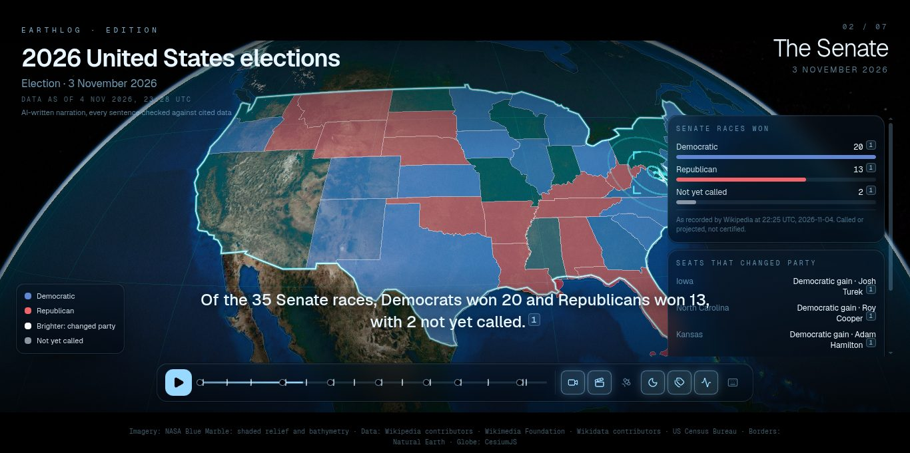
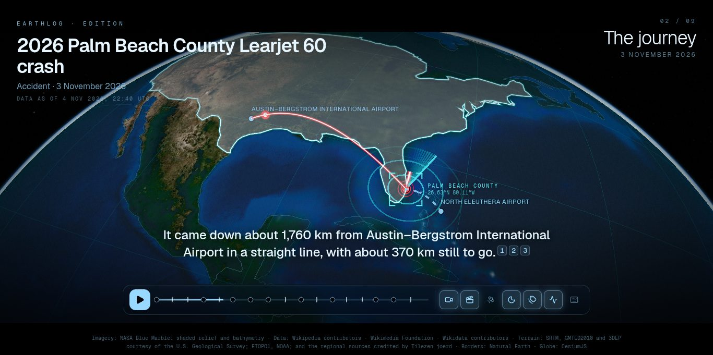
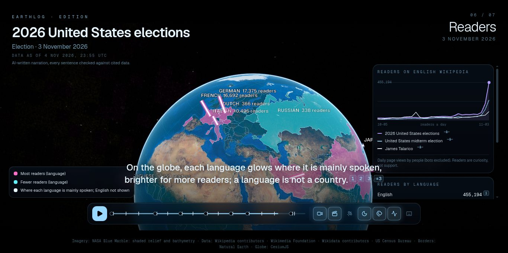
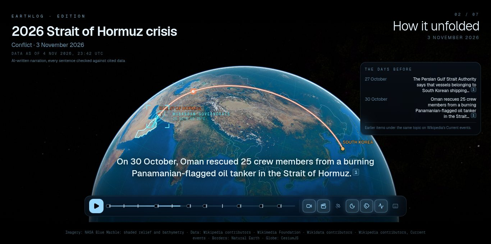
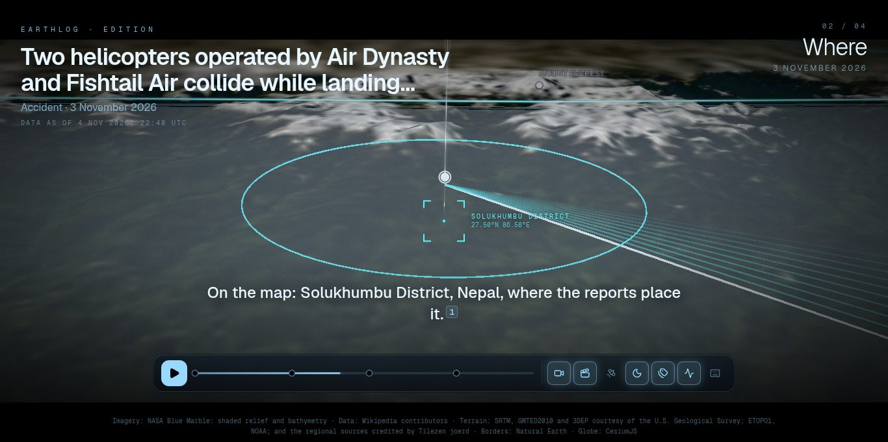

<h1 align="center">🌍 Earthlog</h1>

<p align="center"><strong>Yesterday's world, explained in 3D.</strong><br/>
Every morning, the previous day's hottest stories (every topic, everywhere) become short, cinematic explainers on a 3D globe.<br/>
Each story gets the analysis its kind deserves. Every claim links to its source.</p>

<p align="center"><em>Open source · free · no account · no keys · no tracking</em></p>

<p align="center">
  <a href="https://earthlog-abdi.vercel.app"><strong>earthlog-abdi.vercel.app</strong></a>
</p>

<p align="center"></p>

## What it does

Open Earthlog in the morning and yesterday is waiting on the globe: each story a column of light, coloured by its kind and as tall as the attention it drew. Press **Play the edition** and the camera tours the planet story by story, or open any story's **film**: a 60–120 second explainer you can pause, scrub and explore, with **citation chips on every sentence and every number**.

| When the story is… | Earthlog shows you |
| --- | --- |
| 🗳️ **An election** | Any country's result from its article; in the US, states and districts filling in race by race, flipped seats pulsing, uncalled races grey, parliament charts |
| 👤 **A person** | Their life drawn across the globe, from birthplace to the places that defined them |
| 🏢 **A company or tech story** | A flight to its headquarters, what's on record (founded, staff, revenue over time), the tech community's discussion |
| 💹 **The economy** | The institution, its country in numbers, and its region as 3D columns and a comparison map (World Bank) |
| ⚽ **Sports** | The venue, arcs from the teams' home cities, the result card |
| 🎬 **Culture** | The credits, a trail through the filming locations, where the people credited were born |
| ✈️ **An accident** | The journey (flown in red, the rest dashed), the site on real terrain, the aircraft, who was on board, minute by minute |
| 🌋 **An earthquake** | USGS ShakeMap shaking spreading outward, the fault model, towns as columns of estimated intensity, people exposed |
| ⚔️ **A conflict** | The week day by day, places coloured by recency, sides and figures as the article records them, internet connectivity |
| 🚀 **Science and space** | The launch pad with a beam of light, the mission, the landing |

Every film also has **how it unfolded** (the story's thread through the past week) and the **curiosity map**: who read about it, in which languages, glowing where each language is spoken.

<p align="center">
  
  
</p>
<p align="center">
  
  
</p>

Any film **exports as a video clip** (landscape or vertical) with captions and sources burned in, right in the browser. **Every edition is kept**, so the archive becomes a 3D record of the planet, day by day.

## Why you can trust it

- **Every sentence cites evidence** that exists in the film's bundle; a validator rejects anything else, whoever wrote it.
- **AI is optional, offline and labelled.** A template writes every film; Claude (Haiku) may rewrite the captions once per story at build time, and each chapter is checked in code (citations, every number found in the evidence, no fact dropped) or it keeps the template. Visitors never trigger an AI call.
- **Honest data:** estimates say so, figures are attributed, a language is not a country, and every film says when its data was read ("Data as of"). Editions follow the news for three days, then freeze.
- **Responsible coverage:** [docs/RESPONSIBLE-USE.md](docs/RESPONSIBLE-USE.md).

## How it works

```
every night (GitHub Action):
  what the news reported (eight outlets' headlines + Wikipedia Current events),
  + what the world read (Wikipedia most-read, a bonus when published)
  → stories, typed via Wikidata into a lens, ranked by newsworthiness, balanced across continents
  → each lens bakes free public data (Wikidata, World Bank, USGS, IODA, NASA, terrain tiles…)
  → a film per story (template), optionally directed by Claude, validated, committed
every visitor, free:
  static Next.js pages → a CesiumJS globe plays the films (no AI, no keys, no backend)
```

Details: [docs/ARCHITECTURE.md](docs/ARCHITECTURE.md) · Data and licences: [docs/DATA-SOURCES.md](docs/DATA-SOURCES.md) · Decisions: [docs/decisions.md](docs/decisions.md) · Concept: [docs/CONCEPT.md](docs/CONCEPT.md)

## Run it locally

Requires Node 24+ and pnpm.

```bash
pnpm install
pnpm dev                          # http://localhost:3000
```

Keys in a film: <kbd>Space</kbd> play/pause · <kbd>←</kbd>/<kbd>→</kbd> seek · <kbd>?</kbd> all shortcuts.

**Make an edition** (free public sources, cached in `.cache/`):

```bash
pnpm edition 2026-11-03           # find, type and rank that day's stories
pnpm stories 2026-11-03           # film every story (template narration)
pnpm direct 2026-11-03 --ai       # optional: Claude narration (needs ANTHROPIC_API_KEY in .env)
pnpm validate:scenes              # every sentence must cite real evidence
```

## Deploy your own

1. Import the repository on [Vercel](https://vercel.com/new) (framework: Next.js; no environment variables needed for the site).
2. In GitHub → Settings → Secrets and variables → Actions, add `ANTHROPIC_API_KEY` (optional; without it, films keep their template narration).
3. GitHub → Actions → **Nightly edition** → *Run workflow* once. From then on it runs every night at 00:40 UTC and each commit deploys.
4. Set `NEXT_PUBLIC_SITE_URL` on Vercel if you use your own domain.

## Data credits

Wikipedia and Wikidata (Wikimedia contributors) · Wikimedia pageviews · NASA GIBS / Blue Marble · USGS (earthquakes, ShakeMap, PAGER; SRTM, GMTED2010 and 3DEP terrain) · NOAA ETOPO1 · Tilezen joerd terrain tiles · IODA (Georgia Tech) · World Bank · Hacker News (Algolia) · Natural Earth · US Census Bureau. Licences per source: [docs/DATA-SOURCES.md](docs/DATA-SOURCES.md).

## Contributing

Add a lens, a data source or a classic: [CONTRIBUTING.md](CONTRIBUTING.md). Changes: [CHANGELOG.md](CHANGELOG.md).

## License

MIT. Data keeps its own licences; text adapted from Wikipedia is CC BY-SA 4.0.
