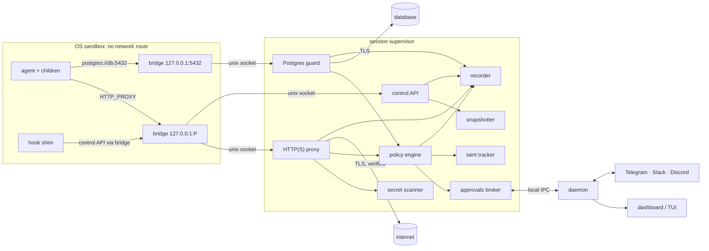

# Mooring: architecture

- **Status:** design draft. Nothing is built. Phases are in [../PLAN.md](../PLAN.md); guarantees in [THREAT-MODEL.md](THREAT-MODEL.md).
- **Rule:** if code and this document disagree, one of them is a bug. Update this file in the same change.

---

## 1. The idea in one picture

```
 ┌──────────────────────────── your machine ─────────────────────────────────┐
 │                                                                            │
 │  you ── terminal ── mooring claude                                         │
 │                        │                                                   │
 │                        ▼                                                   │
 │   ┌──────────── session supervisor (Node, outside the sandbox) ─────────┐  │
 │   │  policy engine · secret scanner · taint · approvals broker           │  │
 │   │  HTTP(S) proxy ─────────────────────────────────┐                    │  │
 │   │  Postgres guard ────────────────────────────┐   │                    │  │
 │   │  snapshotter · recorder · control API       │   │                    │  │
 │   └───────▲──────────────────▲──────────────────┼───┼────────────────────┘  │
 │           │ unix socket(s)   │ events            │   │  only these two      │
 │           │                  ▼                   │   │  talk to the world   │
 │   ┌───────┴────────── OS sandbox ──────────┐  ┌─┴───┴──────┐                │
 │   │ bridge 127.0.0.1:P  →  supervisor      │  │ upstream   │──► internet    │
 │   │ agent (claude) + every child process   │  │ connections│──► databases   │
 │   │ no route out · read-only $HOME         │  └────────────┘                │
 │   │ project dir writable · own /tmp        │                                │
 │   └────────────────────────────────────────┘                                │
 │                                                                            │
 │   optional: mooring daemon (harbormaster) ── dashboard 127.0.0.1 + token   │
 │                                      └──── Telegram / Slack / Discord      │
 └────────────────────────────────────────────────────────────────────────────┘
```

The agent and everything it spawns live inside an OS sandbox with **no network route**. The only exits are loopback ports bridged to Mooring's supervisor, which runs outside the sandbox and makes every upstream connection itself. Whatever the agent does, its packets either go through Mooring or go nowhere.

---

## 2. Components

| Component | Runs where | Responsibility | Phase |
| --- | --- | --- | --- |
| **CLI** (`mooring`) | Your shell | Parses commands (commander, ADR-0003). `mooring <agent>` turns into a session supervisor; other commands are short-lived clients | 0 |
| **Session supervisor** | One Node process per moored session, outside the sandbox | Owns every enforcement component for that session. **Safety never depends on anything else running** (ADR-0009) | 0 |
| **Sandbox launcher** | Inside the supervisor | Builds the per-OS sandbox (bwrap on Linux and WSL2, `sandbox-exec` on macOS) and spawns the agent in it. Runs the platform preflight | 0 |
| **Bridge** | Inside the sandbox | Tiny loopback listener(s) forwarding to supervisor sockets. A Node script, or `pasta --splice-only` (decided in Phase 1, see §4.1) | 0 |
| **HTTP(S) proxy** | Supervisor | CONNECT handling, destination policy **before DNS**, TLS interception with Mooring's CA, request scanning, HTTP guards, holding requests for approval | 0–1 |
| **Secret scanner** | Supervisor (pure module) | Builds the secret inventory and its encoded variants; scans hostnames, URLs, headers and bodies; tracks fragments across requests | 0–1 |
| **Taint tracker** | Supervisor (pure module) | Marks the session tainted when untrusted content arrives; the policy engine reads the taint state | 1 |
| **Snapshotter** | Supervisor | Content-addressed snapshots of the project per step; restore, diff (ADR-0010) | 2 |
| **Recorder** | Supervisor | Appends redacted events to the session log; feeds the timeline and replay | 0 (basic), 2 |
| **Postgres guard** | Supervisor | Wire-protocol proxy. Parses SQL (libpg_query WASM), classifies, snapshots, holds destructive statements for approval | 3 |
| **Policy engine** | Supervisor (pure module) | `decide(event, policy, sessionState) → verdict`. Layered policy files validated by Zod | 1 (basic), 4 |
| **Approvals broker** | Supervisor, plus the daemon for remote channels | Creates approval requests, collects answers, enforces single-use and expiry, **denies on timeout** | 4 |
| **Agent adapters** | Supervisor | Per agent: how to launch it, which env vars and flags to set, which config files to protect, how to install our hooks, where steps come from | 0 (Claude Code), 2–5 |
| **Hook shim** (`mooring hook …`) | Inside the sandbox, started by the agent's hook system | Reports steps and asks for approvals through the control API. **Advisory only** (ADR-0011) | 2, 4 |
| **Daemon** (harbormaster) | One per user, a systemd user unit, LaunchAgent or Windows service | Aggregates sessions, serves the dashboard, runs the chat-channel bots, holds the cross-session timeline, garbage-collects snapshots | 5 |
| **Dashboard** | Browser → daemon on 127.0.0.1 | Timeline, approvals, diffs, undo | 5 |
| **TUI** | Terminal → daemon | Same as the dashboard, for terminal people | 5 |
| **Plugins** | Loaded by the supervisor and daemon | Agent adapters, guards (Postgres, MySQL, Redis, Terraform, AWS, kubectl, Railway…), approval channels | 4+ |
| **Native helper** (slot, not planned yet) | Optional binary | Only if research proves we need kernel-level features Node can't reach: two-stage seccomp, Landlock, Windows WFP. See §4.4 | — |

---

## 3. How the parts talk



| From → to | Transport | Notes |
| --- | --- | --- |
| Agent → proxy | HTTP proxy protocol over the bridge | `HTTP_PROXY`/`HTTPS_PROXY` (both cases), `ALL_PROXY` and `NODE_USE_ENV_PROXY=1` are set. Tools that ignore them simply fail to connect, which fails closed |
| Agent → Postgres guard | Postgres protocol over the bridge | The agent keeps its normal connection string. On Linux, `/etc/hosts` inside the sandbox maps a guarded remote host name to a loopback address |
| Hook shim / agent → control API | HTTP to a reserved path on the proxy listener | **Request-only API**: report a step, ask for approval, poll a decision. Nothing reachable from inside can *grant* an approval |
| Supervisor ↔ daemon | Unix socket (named pipe on Windows), mode 0600, in the user's runtime dir | The supervisor works without it. If it connects, it streams events and receives remote approval answers |
| Browser → daemon | HTTP on **127.0.0.1 only**, random token, `Host` header check | Lessons from OpenClaw's exposed gateways: no `0.0.0.0`, no "trust localhost" |
| Daemon ↔ chat platforms | Outbound only: Telegram long polling, Slack Socket Mode, Discord gateway | No inbound port, so it works behind NAT, and all three are on free tiers |
| `mooring undo/diff/timeline/approve` | Reads the state dir; talks to the live supervisor over its control socket | Works with the daemon down |

---

## 4. The sandbox, per OS

Research details and sources are in [THREAT-MODEL.md](THREAT-MODEL.md) §5 and ADR-0004. Here is the mechanism.

### 4.1 Linux, and WSL2 (the reference platform)

**Launch.** `bwrap` (the **system** `/usr/bin/bwrap`) runs with:

- `--unshare-all`, which includes the network namespace (only `lo` inside);
- `--die-with-parent`, `--new-session` and `--disable-userns`.

**Filesystem view:**

- `/usr`, `/etc` and the other system dirs are read-only.
- `$HOME` is read-only, with **masks** (tmpfs or empty binds) over protected paths. Defaults to decide in Phase 1: `~/.ssh` private keys, `~/.gnupg`, password stores, browser profiles, Mooring's own state dir.
- Writable: the project dir; the agent's own state dirs (for example `~/.claude`); caches (`~/.npm`, `~/.cache`); a private `/tmp`.
- **Masked:** `/run/user/$UID` (systemd user bus: `systemd-run --user` would escape), `/var/run/docker.sock`, `SSH_AUTH_SOCK`, D-Bus and X11/Wayland sockets.

**Files overlaid inside the sandbox only.** A mount namespace lets us do this without root:

- `/etc/resolv.conf` is empty, so there is no DNS.
- `/etc/hosts` maps guarded DB hosts to loopback.
- `/etc/ssl/certs/ca-certificates.crt` is the system bundle **plus Mooring's CA**. This is how Go, Rust and other tools that ignore env vars trust interception, **without touching the host trust store**.
- Agent config files are bound read-only. For Claude Code that means its `settings.json` files, plus a managed-settings file at `/etc/claude-code/managed-settings.json` carrying our hooks (verify in Phase 2).

**Environment:**

- Proxy variables are set.
- CA variables are set: `NODE_EXTRA_CA_CERTS`, `SSL_CERT_FILE`, `REQUESTS_CA_BUNDLE`, `CURL_CA_BUNDLE`, `GIT_SSL_CAINFO`, `PIP_CERT`, `CODEX_CA_CERTIFICATE`, `DENO_CERT`.
- Unset: `SSH_AUTH_SOCK`, `DBUS_SESSION_BUS_ADDRESS`, `DOCKER_HOST`, `WSL_INTEROP`.

**Bridge.** srt and Codex both bind-mount Unix sockets and run a TCP↔UDS bridge inside the sandbox ([srt](https://github.com/anthropic-experimental/sandbox-runtime), [Codex](https://github.com/openai/codex/blob/main/codex-rs/linux-sandbox/README.md)). Mooring starts with the same pattern, using a small Node bridge script so there's no `socat` dependency.

Phase 1 decides between two ways to add **seccomp**, which blocks new `AF_UNIX` sockets, `io_uring` and `AF_VSOCK`:

- **Two-stage launch:** the bridge starts first, then the filter is applied to the agent only. This is how srt does it. Without a native helper it's awkward.
- **`pasta --splice-only`:** it forwards loopback ports between namespaces, so there's no Unix socket inside at all and one bwrap-level filter covers everything. Untested with bwrap, so it needs a prototype.

The cBPF program for `bwrap --seccomp FD` can be generated in pure TypeScript.

**Preflight** (`mooring doctor`, and every launch). Tested on this dev machine (Ubuntu 24.04, kernel 7.0):

- On Ubuntu 24.04, `kernel.apparmor_restrict_unprivileged_userns=1` makes **every** unprivileged bwrap namespace fail from a normal terminal: `setting up uid map: Permission denied`, `loopback: Failed RTM_NEWADDR`.
- It *works* inside VS Code's integrated terminal, because VS Code runs under its own AppArmor profile. **A test from an IDE terminal proves nothing about a plain terminal.**

The fix is a one-time root step:

- Install the distro's `bwrap-userns-restrict` AppArmor profile (Ubuntu 25.04+ ships it; on 24.04 it comes from `apparmor-profiles` extras). That profile attaches **only to `/usr/bin/bwrap`**.
- The other option is to flip the sysctl. That weakens the whole machine, so we won't recommend it.

`mooring onboard` offers the profile fix with consent. If the sandbox can't be built, Mooring **refuses to start the agent**. There is no silent fallback to running unsandboxed.

**Nested sandboxes.** Agents with their own sandbox (Claude Code `/sandbox`, Codex) need nested user namespaces, which `--disable-userns` forbids. Allowing them would let the agent undo our read-only mounts ([srt notes](https://github.com/anthropic-experimental/sandbox-runtime)). Adapters therefore launch agents with **their own sandbox switched off**; Mooring's sandbox replaces it. The network guarantee would survive nesting anyway, because the netns is inherited; only the filesystem guarantee would weaken.

**WSL2.** All of Mooring runs inside the distro, so it's the same code path. WSL-specific hardening:

- Hide `/run/WSL` and unset `WSL_INTEROP`, so the agent can't launch Windows `.exe` files outside the namespaces.
- Don't bind `/mnt/c`.
- WSL1 is unsupported.

### 4.2 macOS

**Launch.** `/usr/bin/sandbox-exec` with a generated SBPL profile:

- outbound network allowed only to `localhost:<proxy port>` and the DB bridge ports (the same approach as Codex and srt);
- file writes only to the project, the agent state dirs, caches and a private temp dir;
- reads of protected paths denied.

**Known weaknesses, documented rather than hidden:**

1. `sandbox-exec` has been marked deprecated for years and has no replacement for headless tools. Apple could break it in any release. Our mitigation is a launch-time self-test that a direct connection to an external IP **fails**.
2. DNS resolution goes through system daemons, so DNS-query exfiltration may be possible. We'll test whether denying `mach-lookup` to the resolver closes it without breaking proxied traffic.
3. Anything launched via launchd, XPC, `open` or Apple Events runs outside the sandbox. The profile denies these broadly, at some compatibility cost.
4. We can't fake the system trust store per process. Tools that use the macOS keychain for TLS trust will **fail closed** against intercepted hosts unless you opt in to adding Mooring's CA to your login keychain.
5. Node can't clone files on macOS (libuv reverted `copyfile` cloning). If reflink speed matters, the snapshotter shells out to `cp -c`.

**Rejected alternatives:**

- Endpoint Security and Network Extension need Apple entitlements and a paid developer account.
- Apple's `container` (macOS 26, Apple silicon) or a Lima VM could host the Linux sandbox as an optional "VM mode" later.

### 4.3 Windows

- **Phase 1–5: WSL2.** `install.ps1` installs Mooring *inside* WSL2 and runs agents there.
- **Native Windows, later.** The candidate is **Microsoft Execution Containers (MXC)**:
  - GA in October 2026, with an MIT npm SDK, `@microsoft/mxc-sdk`.
  - Pre-release v0.8.0 states that it "blocks direct network access and permits only the configured loopback HTTP/S proxy endpoint" ([repo](https://github.com/microsoft/mxc), [v0.8.0](https://github.com/microsoft/mxc/releases/tag/v0.8.0)).
  - Full proxy-only support needs very new Windows builds.
  - Microsoft ships and signs the native code, which fits our "no native code" rule.
- **Rejected for now:**
  - WFP filters (srt's alpha approach) need admin and a sandbox user, and have known bypasses.
  - AppContainer has no "loopback port only" mode.
  - Windows Sandbox needs Pro and a VM.
- **Until native support lands,** `mooring` on native Windows refuses to claim protection. It points you to WSL2.

### 4.4 Slot for a native helper

`packages/helper/` is reserved, not planned. It would be a small, separately built, **optional** binary with a JSON-over-argv interface. The launcher checks for its presence and reports features as available or missing.

Candidates, only if Phase 1 research proves Node can't do them:

- two-stage seccomp application on Linux;
- Landlock (TCP port rules, ABI 4+, as defence in depth);
- Windows WFP.

Adding it needs an ADR, because it changes the build, signing and supply-chain story.

---

## 5. Data flows

### 5.1 An outbound HTTPS request

1. A tool inside the sandbox sends `CONNECT api.example.com:443` to the bridge, which forwards it to the proxy.
2. **Destination policy runs before any DNS lookup**: deny, intercept or passthrough. The hostname itself is scanned for secrets, because DNS-style exfiltration through the proxy looks like `<secret>.attacker.tld`.
3. **Intercept.** The proxy terminates TLS with a leaf certificate minted for the SNI name, signed by Mooring's CA (@peculiar/x509, ECDSA P-256, cached per host). The intercepted side speaks HTTP/1.1 only at first (ADR-0005).
4. For each request:
   - Decode `Content-Encoding`.
   - Scan the URL, headers and body against the secret inventory and its variants. Fragments seen across requests are tracked per destination.
   - Run HTTP guards, for example "Railway GraphQL `volumeDelete`".
   - Ask the policy engine. Bodies are **buffered up to a cap and fully scanned before a single byte goes upstream**. Bodies over the cap are refused unless the destination is allowlisted for large uploads.
5. The verdict is one of:
   - **allow**: forward over TLS to the real host, verifying its certificate against the normal trust store;
   - **deny**: a `403` with a plain-English explanation in the body, which the agent reads and usually relays to you;
   - **ask**: hold the request open while the approvals broker waits, then allow or deny.
6. The response is recorded. If the content came from an untrusted source (§5.4), the session is tainted.
7. **Passthrough** hosts (pinned or incompatible clients) get destination policy only, with no content inspection. The timeline says so.

### 5.2 A destructive SQL statement

1. The agent connects to `db.internal:5432`. That name resolves to loopback inside the sandbox, and the bridge forwards it to the Postgres guard.
2. The guard relays startup and authentication. `SCRAM-SHA-256-PLUS` is removed from the offered mechanisms, because channel binding can't survive a proxy. If upstream needs TLS, the guard connects with TLS.
3. For `Query` and `Parse` messages, the guard parses each statement with libpg_query and classifies it. **A parse failure is treated as destructive.**
4. If a statement is destructive:
   - Record it.
   - Snapshot what's about to change, for example `CREATE TABLE mooring_snapshots.<t>_<ts> AS TABLE <t>` over a separate admin connection, or `pg_dump` for whole-schema operations.
   - Hold the statement for approval.
   - On deny, return a Postgres `ErrorResponse` explaining why.
5. Everything else streams through. Server→client messages are parsed with `pg-protocol` to record row counts and errors.

### 5.3 A step and an undo

1. The agent's hook (Claude Code `PreToolUse`) runs `mooring hook pre-tool`, which calls the control API.
2. The supervisor snapshots the project and records the step boundary, and the hook returns.
3. Agents without hooks fall back to quiescence-based steps: a snapshot after N ms without file changes, and before each model request if the model API host is intercepted. This is decided in Phase 2.
4. `mooring undo 3`:
   - takes a snapshot of *now* (so undo is undoable);
   - computes the diff to the state before step `n-3`;
   - writes files atomically, deletes files that didn't exist then, and restores modes and symlinks;
   - records an `undo` event.

### 5.4 Taint

Content counts as untrusted when it:

- comes from a host outside the session's trusted set;
- arrives as an MCP tool result;
- is a file read from dependency directories (via `PostToolUse` hooks, **advisory**);
- is an issue or PR body fetched from a forge API.

Taint is **session-level, not per-byte data-flow tracking**. The docs must say this plainly. A tainted session makes the policy engine stricter. The defaults are decided in Phase 1, for example: any request with a body to a host first contacted after the taint needs approval.

---

## 6. Where state lives

| What | Linux / WSL2 | macOS | Windows (native, later) | Visible inside sandbox? |
| --- | --- | --- | --- | --- |
| User config and policy | `$XDG_CONFIG_HOME/mooring/` (`~/.config/mooring/`) | `~/Library/Application Support/Mooring/config/` | `%APPDATA%\Mooring\` | **Read-only**, or masked |
| Project policy | `<project>/.mooring/policy.yaml` (may only **tighten** user policy) | same | same | Read-only |
| State: session logs, snapshot store, CA | `$XDG_STATE_HOME/mooring/` (`~/.local/state/mooring/`) | `~/Library/Application Support/Mooring/state/` | `%LOCALAPPDATA%\Mooring\` | **Masked** |
| CA private key | `<state>/ca/` mode 0600 | same | DPAPI-protected (later) | **Masked** |
| Runtime sockets | `$XDG_RUNTIME_DIR/mooring/` | `$TMPDIR/mooring-<uid>/` | named pipes | Only the bridge sockets |
| Chat bot tokens | User config, mode 0600 | same | same | Masked |

- **Session log:** append-only JSONL, one file per session, with every event schema-validated by Zod. Each event carries `ts`, `session`, `step`, `kind`, a redacted payload and refs to snapshot objects. JSONL keeps it greppable and crash-tolerant. A SQLite index (`node:sqlite`) for the cross-session timeline is a Phase 5 decision.
- **Snapshot store (ADR-0010):** content-addressed objects (`objects/<sha256>`, zstd via `node:zlib`) plus one manifest per step, and a stat cache keyed on (path, size, mtime, inode).
  - Excluded by default but *recorded*: regenerable dirs (`node_modules/`, `.venv/`…), with their lockfile hash.
  - Retention is by age and size quota, with a garbage collector.
- **Secrets are never written to disk by Mooring.** The inventory is built in memory at session start. Logs refer to a secret by name and fingerprint, for example `STRIPE_KEY from .env (sha256:1a2b…)`.

---

## 7. Planned repository layout

```
packages/mooring/          the published CLI + supervisor + daemon (one package until a second consumer exists)
  src/cli/                 commands
  src/session/             supervisor lifecycle
  src/sandbox/{linux,macos,windows}/
  src/proxy/               CONNECT, TLS, HTTP/1.1, guards hook-in
  src/secrets/             inventory, variants, scanner (pure)
  src/taint/               (pure)
  src/policy/              schema + decide() (pure)
  src/snapshots/           CAS, manifests, restore
  src/dbguard/postgres/
  src/approvals/           broker + channels
  src/recorder/
  src/adapters/{claude-code,codex,opencode,...}/
  src/daemon/
packages/sdk/              plugin SDK (Phase 4)
packages/helper/           reserved for a native helper (needs an ADR)
apps/dashboard/            (Phase 5)
site/                      website + docs, Astro Starlight (Phase 6)
scripts/                   install.sh, install.ps1, release scripts (Phase 5)
test/escape/               the escape suite: one test per guarantee in THREAT-MODEL.md
config/site.json           THE site URL, the single source of truth (ADR-0006)
docs/                      CONCEPT, ARCHITECTURE, THREAT-MODEL, decisions
```

**Pure modules have no I/O:** `secrets`, `taint` and `policy`. They take data and return verdicts, so the parts that decide what is safe can be unit-tested exhaustively without a sandbox.
